# MiB-BI

Clone **educativo** di Power BI Desktop per Linux: stessa struttura dell'interfaccia
(ribbon, viste Report/Tabella/Modello, riquadri Filtri · Visualizzazioni · Dati) e
stesso flusso di lavoro (Ottieni dati → Strumento di navigazione → trascina i campi → report).

Non è affiliato a Microsoft; nome e logo sono volutamente diversi.


## Screenshot

| | |
|---|---|
|  |  |
| **Riquadro Analisi** — linee costante, min, max, media, mediana, percentile e di tendenza | **Pulsanti** — Applica / Cancella tutti i filtri dei dati, drill-through, scheda Azione |
|  |  |
| **Esplora Q&A** — aperto da un pulsante con azione Q&A | **File › Ottieni dati** — tutte le origini dal menu File |
|  |  |
| **Opzioni e impostazioni** — caricamento dati, script Python/R, Q&A, Data/ora automatica | **Modello e DAX** — IntelliSense nella barra della formula, cartelle di visualizzazione, gerarchie utente, gruppo di calcolo in una matrice |
|  |  |
| **Gestisci ruoli** — sicurezza a livello di riga con filtri DAX per tabella | **Visualizza come** — il report visto dal ruolo *Europa* (barra gialla, filtro propagato ai fatti) |
|  |  |
| **Analisi** — previsione con intervallo di confidenza, area ombreggiata, barre di errore da campi, formato dinamico di un elemento di calcolo | **Pubblica** — accesso con l'account aziendale, ricerca tra tutte le aree di lavoro, scelta della destinazione |
|  |  |
| **Ottieni dati › Power BI** — report (.pbix) e modelli semantici delle proprie aree di lavoro | **File › Salva come file Power BI (.pbix)** — report, modello e dati in un vero `.pbix` |
|  |  |
| **Il `.pbix` di MiB-BI in Power BI Desktop** — misura DAX, colonna calcolata, gerarchia, ruolo e dati caricati senza aggiornare | **Database SQL Server** — tabelle e viste con anteprima; anche Oracle, Snowflake, BigQuery, Databricks, ClickHouse, MongoDB, Access, ODBC |
|  |  |
| **Modifica interazioni** — evidenziazione (barre piene/sbiadite), filtro o nessuna, per ogni coppia di oggetti visivi | **Filtri dei dati** — Tra (date e numeri), data relativa, testo, pulsanti; **Sincronizza filtri dei dati** tra le pagine |
|  |  |
| **Mostra come tabella** ed **Esporta dati** — dati riepilogati (.xlsx/.csv) o sottostanti (.xlsx) | **Tema scuro** — interfaccia chiara, scura o come il sistema; la pagina del report mantiene il proprio tema |
|  |  |
| **Nuovo calcolo visivo** — anteprima, barra della formula, matrice visiva con i campi nascosti, modelli | **Calcoli visivi nel report** — media mobile su una linea, % del totale e differenza dal precedente, campo nascosto |
|  |  |
| **Opzioni calendario** — categorie Anno/Trimestre/Mese/Settimana/Data, colonne associate e correlate al tempo | **Funzioni definite dall'utente** e time intelligence a calendario (`TOTALWTD`, `DATEADD` su un calendario) nella Vista query DAX |
| 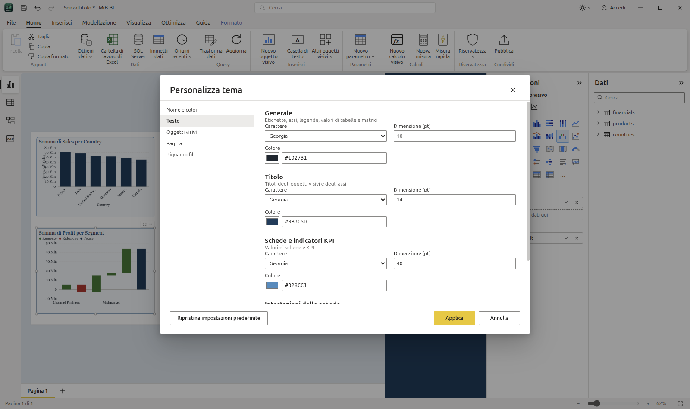 | 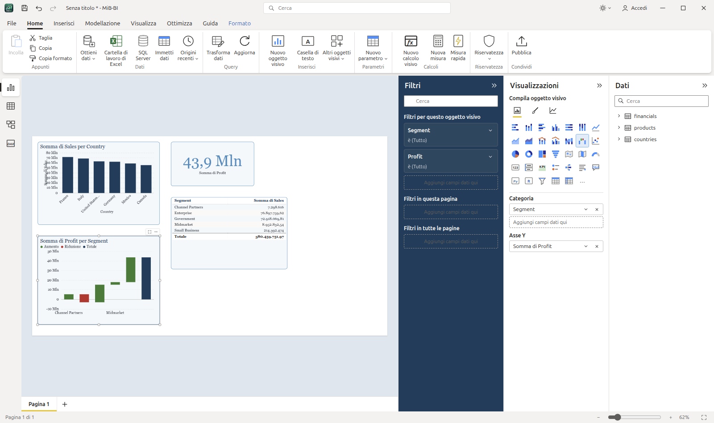 |
| **Personalizza tema** — colori, testo, oggetti visivi, pagina e riquadro filtri, salvati nel JSON del tema | **Tema personalizzato** — caratteri e colori dei testi, sfondo e bordo degli oggetti visivi, riquadro filtri, colori di sentiment |
| 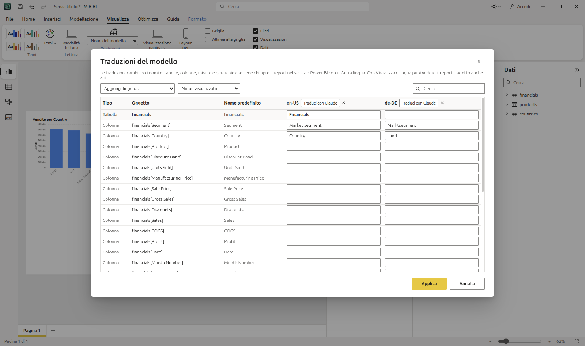 | 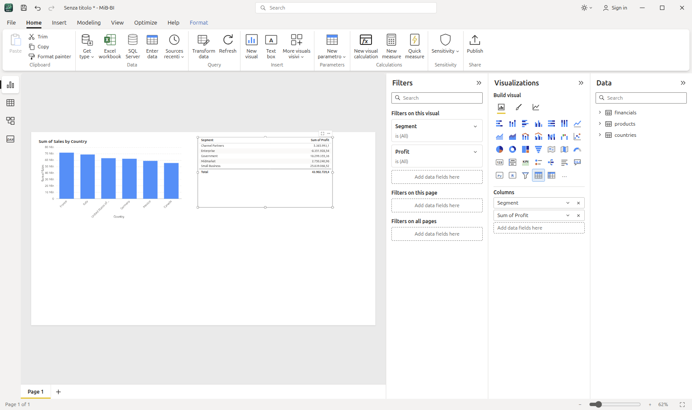 |
| **Traduzioni del modello** — nomi di tabelle, colonne e misure per lingua, *Traduci con Claude*, anteprima con Visualizza › Lingua | **Interfaccia in inglese** — Opzioni › Impostazioni internazionali › Lingua dell'applicazione |
| 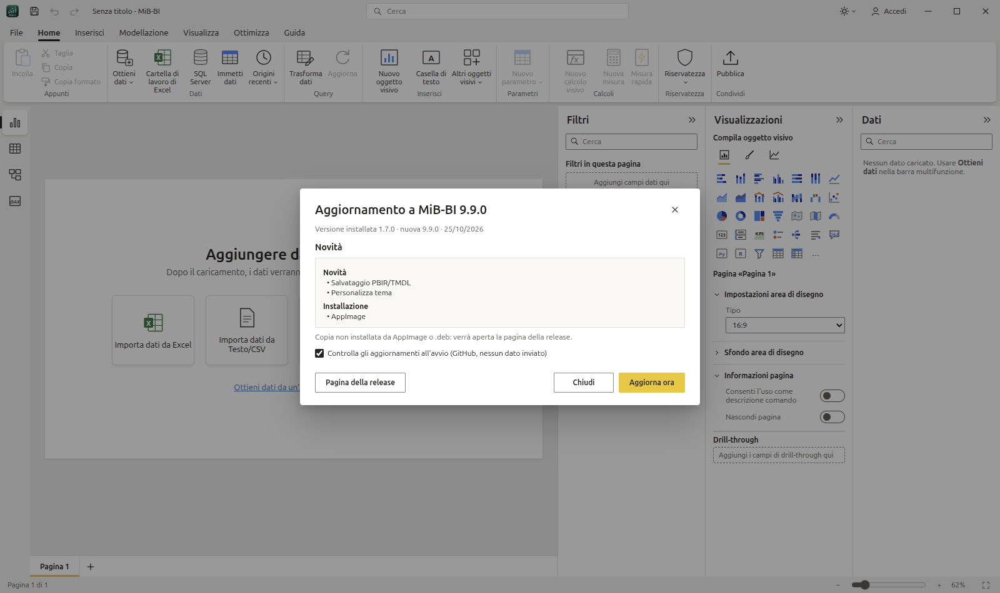 | 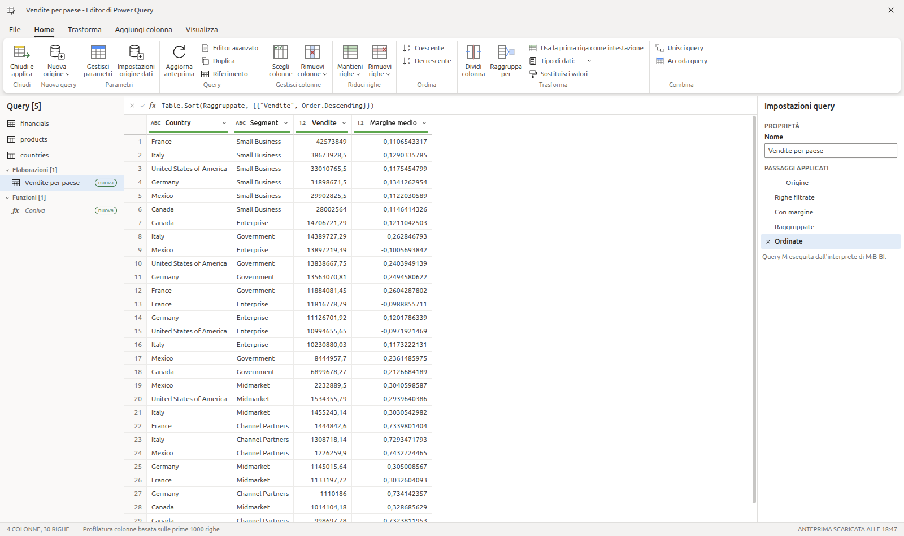 |
| **Aggiornamenti** — avviso di una nuova release su GitHub, novità, download e installazione con riavvio | **Linguaggio M completo** — query M con i passaggi applicati (uno per riga del `let`), gruppi di query, funzioni |
| 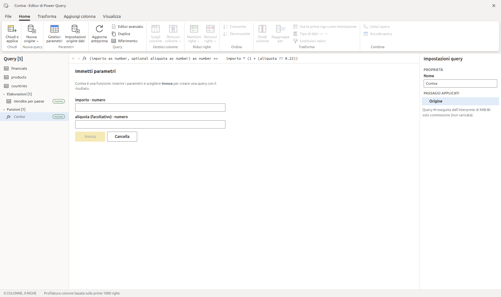 | 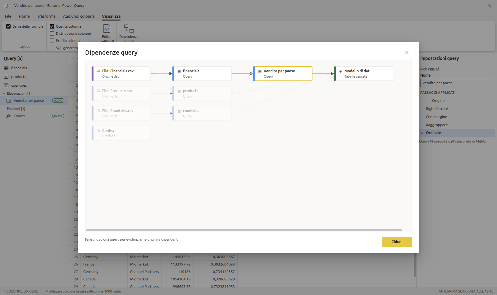 |
| **Funzione personalizzata** — *Immetti parametri* e *Invoca*, query solo connessione | **Dipendenze query** — origini → query → modello, evidenziazione di una query |
| 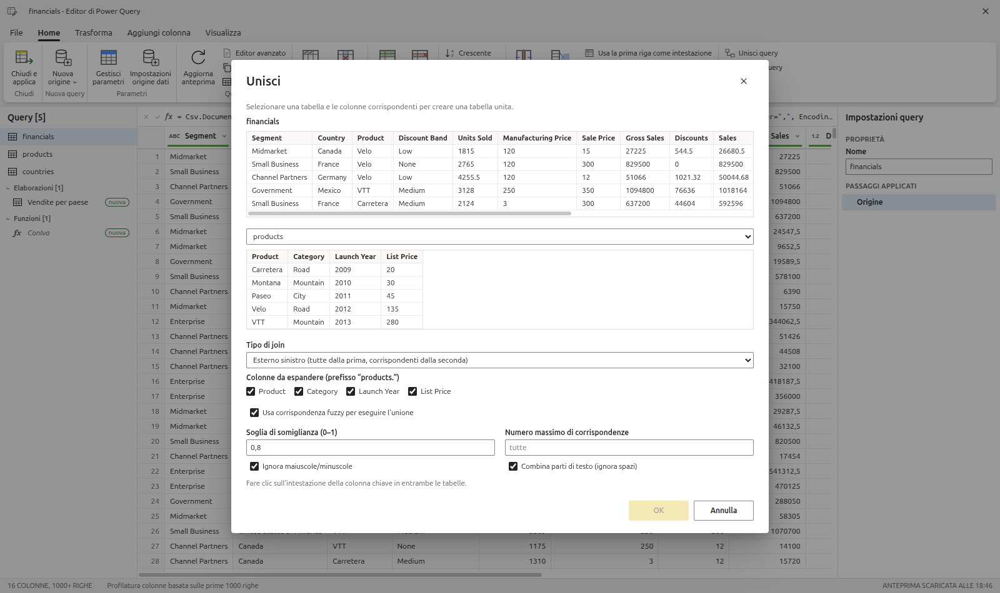 | 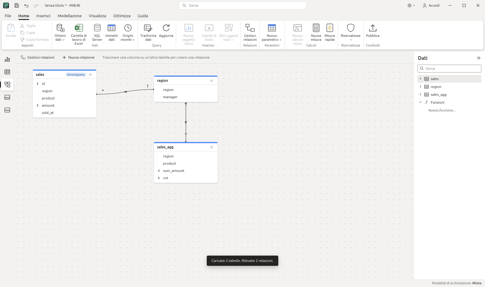 |
| **Unisci query con corrispondenza fuzzy** — soglia, maiuscole/minuscole, spazi, numero di corrispondenze | **Modello composito** — tabella DirectQuery su SQLite, tabella di aggregazione, *Modalità di archiviazione: Mista* nella barra di stato |
| 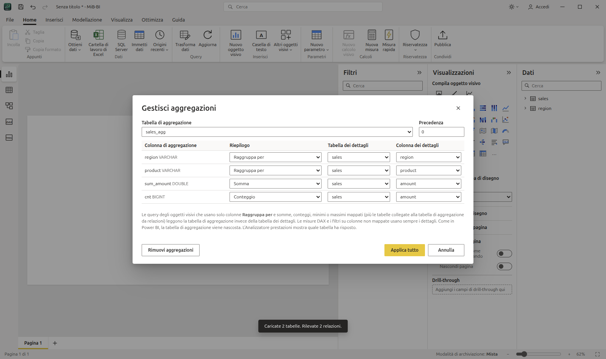 | 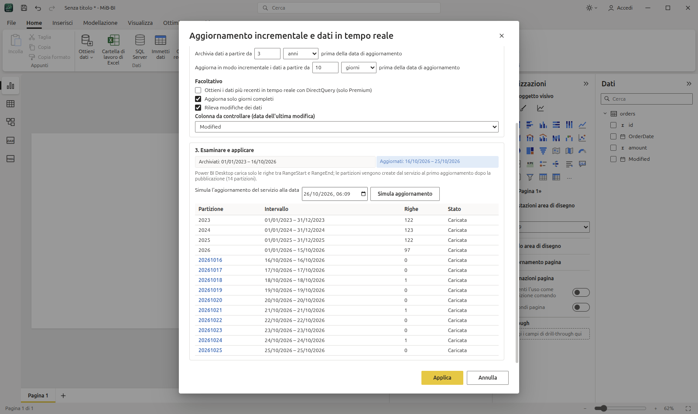 |
| **Gestisci aggregazioni** — Raggruppa per, Somma, Conteggio verso la tabella dei dettagli DirectQuery | **Aggiornamento incrementale** — criteri, simulazione dell'aggiornamento del servizio con le partizioni e rilevamento modifiche |
| 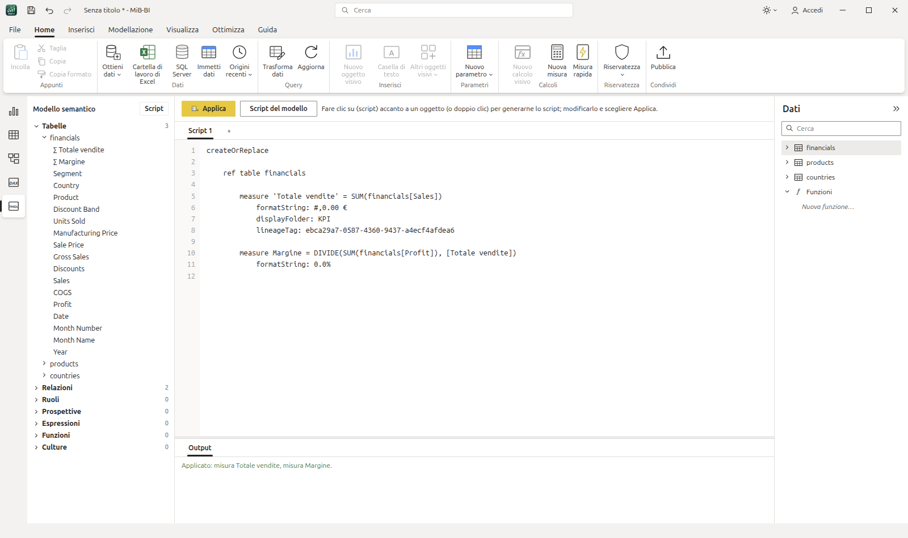 | 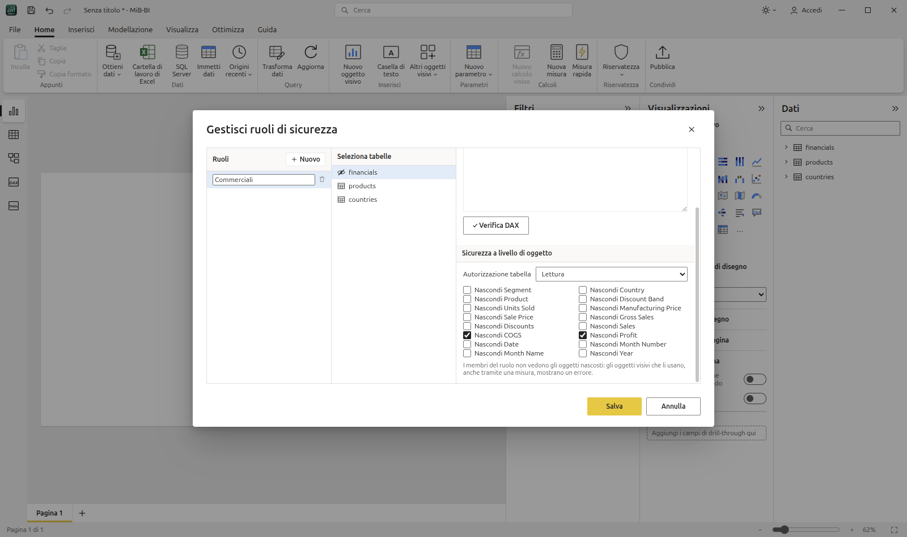 |
| **Vista TMDL** — script `createOrReplace` degli oggetti, modifica e *Applica* | **Sicurezza a livello di oggetto** — colonne nascoste per ruolo in Gestisci ruoli |
| 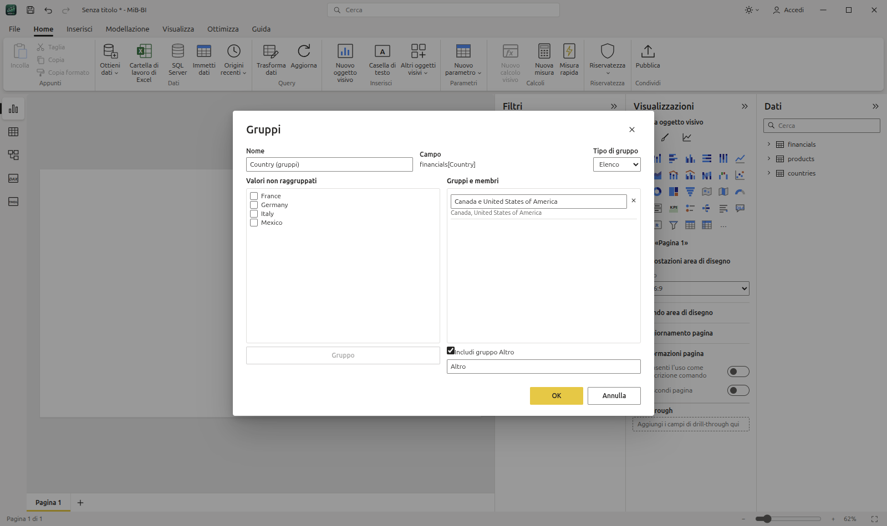 | 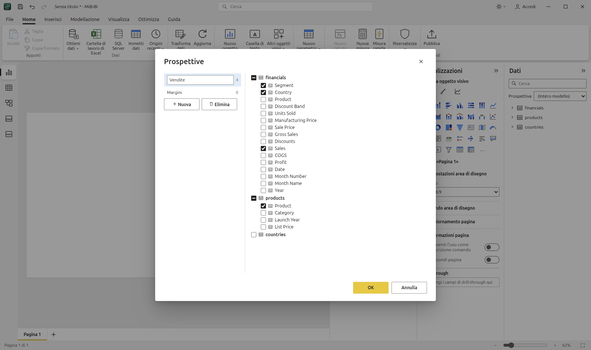 |
| **Nuovo gruppo** — valori raggruppati in un elenco con *Altro*, o intervalli di numeri e date | **Prospettive** — sottoinsiemi del modello scelti nel riquadro Dati |

## Scaricare e installare

Dalla pagina [Releases](https://github.com/mbulloni/MiB-BI/releases) (Linux x64):

```bash
# AppImage (qualsiasi distribuzione)
chmod +x MiB-BI-<versione>.AppImage && ./MiB-BI-<versione>.AppImage

# oppure pacchetto Debian/Ubuntu (voce di menu e associazioni file incluse)
sudo apt install ./mib-bi_<versione>_amd64.deb
```

Per aprire e salvare i file `.pbix` di Power BI serve Python 3 con la libreria `pbixray` (una volta sola):

```bash
sudo apt install python3-venv     # se manca il modulo venv
python3 -m venv ~/.config/mib-bi/pbix-venv
~/.config/mib-bi/pbix-venv/bin/pip install pbixray pyarrow
```

MiB-BI usa da solo questo ambiente. I file `.pbit`, `.pbip`, `.mibx` e tutte le altre origini non richiedono Python.
La prima volta che si usano Excel o un database, DuckDB scarica la relativa estensione (serve la rete).

## Sviluppo

```bash
npm install
npm run setup:pbix                      # opzionale: lettura dei file .pbix (Python + pbixray)
node node_modules/electron/install.js   # solo se npm ha bloccato lo script di Electron
npm run dev      # Vite + Electron con hot reload
npm start        # build di produzione + Electron
npm run dist     # AppImage in release/ (npm run dist:deb per il .deb)
```

### Installazione (utente, senza root)

```bash
install -m 755 release/MiB-BI-<versione>.AppImage ~/Applications/MiB-BI.AppImage
ln -sf ~/Applications/MiB-BI.AppImage ~/.local/bin/mib-bi
# icone in ~/.local/share/icons/hicolor/*/apps/mib-bi.png (da build/icons), voce di menu
# ~/.local/share/applications/mib-bi.desktop (Exec=…/MiB-BI.AppImage %f) e tipi MIME .mibx/.pbix/.pbit/.pbip
python3 -m venv ~/.config/mib-bi/pbix-venv && ~/.config/mib-bi/pbix-venv/bin/pip install pbixray pyarrow   # apertura .pbix
```

`mib-bi report.mibx` (o doppio clic su un file associato) apre il report all'avvio.

## Architettura

| Power BI          | MiB-BI                                                         |
|-------------------|---------------------------------------------------------------|
| VertiPaq          | DuckDB in-memory (`electron/db.cjs`)                           |
| Query DAX dei visual | SQL generato da `src/query.ts` (GROUP BY + filtri)          |
| Visual            | Apache ECharts + componenti React (`src/visuals/`)             |
| File .pbix        | `.mibx`: zip con `report.json` (report, origini, passaggi, DAX) e un Parquet per tabella |

Flusso: `Data pane` → drag/checkbox → `store.addField` (posizionamento automatico nei
contenitori) → `buildVisualQuery` → IPC `db:query` → render.

Filtri applicati a ogni visual: report → pagina → visual → filtri dei dati (slicer) → filtro
incrociato (click su barra/fetta/riga).

### Relazioni e semantica delle query (fase 3)

- Relazioni normalizzate come in Power BI: `from` = lato molti, `to` = lato uno; cardinalità `*:1`, `1:1`, `*:*`; direzione filtro *Singola* / *Entrambe*; attiva / inattiva.
- Ogni misura viene valutata sulla **propria tabella** (base); dimensioni e filtri vengono uniti con `LEFT JOIN` lungo il percorso più breve di relazioni attive.
- Il filtro scorre dal lato uno al lato molti; al contrario solo con direzione *Entrambe* (o `1:1`, `*:*`). Un filtro su una tabella non raggiungibile viene ignorato, come in Power BI.
- Se il percorso attraversa un salto uno→molti, la base viene deduplicata (`DISTINCT rowid`) per non contare due volte le righe.
- Misure di tabelle diverse nello stesso visual: una sottoquery per tabella, allineate con `FULL JOIN … IS NOT DISTINCT FROM`.
- Rilevamento automatico all'importazione: stesso nome di colonna, tipo compatibile, valori univoci su un lato; i percorsi ambigui vengono creati inattivi.

### Power Query (fase 4)

**Home › Trasforma dati** (o *Trasforma dati* nello Strumento di navigazione, o *Modifica query* nel riquadro Dati) apre
l'**Editor di Power Query**: elenco query, griglia di anteprima (prime 1000 righe, qualità colonna), barra della formula
con il codice M del passaggio selezionato, *Impostazioni query* con i **passaggi applicati** (selezionabili ed eliminabili).

| Gruppo | Trasformazioni |
|---|---|
| Colonne | Scegli colonne, Rimuovi colonne / altre colonne, Rinomina (doppio clic sull'intestazione), Duplica, Tipo di dati |
| Righe | Filtro con elenco valori e filtri per testo/numero/data, Rimuovi vuoti, Mantieni/Rimuovi prime o ultime righe, Rimuovi duplicati, Ordinamento |
| Trasforma | Sostituisci valori, Riempi in basso/in alto, Dividi colonna per delimitatore, Formato (maiuscolo, minuscolo, iniziali maiuscole, taglia, lunghezza), Arrotonda, Valore assoluto, Anno/Trimestre/Mese/Giorno, Trasforma (altre) colonne in valori (unpivot), Raggruppa per |
| Aggiungi colonna | Colonna personalizzata (formula M: `[Col]`, aritmetica, `&`, `if … then … else`, `Text.*`, `Number.*`, `Date.*`), Colonna indice |
| Combina | Unisci query (join esterno sx/dx/completo, interno, anti), Accoda query, Duplica / Riferimento query, Nuova origine |

Ogni passaggio è salvato nella tabella (`steps`, anche nel `.mibx`) e compilato da `src/pq/compile.ts` in una
**pipeline SQL**: una CTE per passaggio, con una colonna nascosta `__r` che conserva l'ordine delle righe come fa
Power Query. Le query referenziate (Riferimento, Unisci, Accoda) vengono incorporate come sottoquery, quindi le bozze
dell'editor si vedono a vicenda prima di *Chiudi e applica*. Lo stesso elenco di passaggi genera il codice M
(`src/pq/m.ts`) mostrato nella barra della formula e nell'*Editor avanzato* ed esportato nel `.pbit`.
*Visualizza › SQL generato* mostra la query DuckDB equivalente: utile per confrontare M e SQL.

Rinominare una query rinomina la tabella anche nel report (campi, filtri, relazioni, misure); rinominare una
colonna con un passaggio non aggiorna gli oggetti visivi che la usano, come in Power BI.
Differenze note: *Modifica tipo* usa `TRY_CAST` (i valori non convertibili diventano `null` invece di *Error*);
l'Editor avanzato è in sola lettura; i passaggi si eliminano ma non si modificano (rifarli dopo averli eliminati).

### DAX (fase 5)

Motore in `src/dax/` (`parse.ts` lexer/parser, `engine.ts` compilatore DAX → SQL). Il **contesto di filtro** è
esplicito: un elenco di filtri, ciascuno un predicato SQL sulle righe di una tabella. Un'aggregazione su una tabella
diventa una sottoquery correlata che applica tutti i filtri, quelli delle altre tabelle tramite *semi-join* lungo le
relazioni attive nella direzione consentita (uno → molti, o entrambe). Da qui la semantica di Power BI:

- **CALCULATE / CALCULATETABLE**: transizione di contesto (righe → filtri), poi `ALL`/`REMOVEFILTERS`/`ALLEXCEPT`/
  `ALLSELECTED` rimuovono filtri, gli argomenti filtro **sostituiscono** quelli sulle stesse colonne (`KEEPFILTERS` li
  interseca), `USERELATIONSHIP` e `CROSSFILTER` cambiano le relazioni. I filtri di tabella seguono le *tabelle espanse*
  (un filtro su `Sales` filtra anche `Product`).
- **Iteratori**: `SUMX`, `AVERAGEX`, `MINX`, `MAXX`, `COUNTX`, `PRODUCTX`, `CONCATENATEX`, `RANKX`, `FILTER`, `ADDCOLUMNS`,
  `SELECTCOLUMNS`, `TOPN`, `SUMMARIZE`, `SUMMARIZECOLUMNS`; una misura dentro un iteratore applica la transizione di contesto.
- **Time intelligence**: `TOTALYTD/QTD/MTD`, `DATESYTD/QTD/MTD`, `SAMEPERIODLASTYEAR`, `DATEADD`, `PARALLELPERIOD`,
  `PREVIOUS*`/`NEXT*`, `DATESBETWEEN`, `DATESINPERIOD`, `FIRSTDATE`/`LASTDATE`, `STARTOF*`/`ENDOF*`, anche su un
  calendario (vedi *Calcoli visivi, funzioni e calendari*).
- Altro: `VAR … RETURN`, `SWITCH`, `SELECTEDVALUE`, `HASONEVALUE`, `ISFILTERED`, `ISINSCOPE`, `RELATED`, `RELATEDTABLE`,
  `LOOKUPVALUE`, `EARLIER`, `TREATAS`, `CALENDAR`, `CALENDARAUTO`, `FORMAT` (formati italiani), funzioni matematiche,
  di testo e di data. Misure su più tabelle senza limitazioni.

Ogni valore (VAR, misura usata più volte nello stesso contesto) viene calcolato una sola volta tramite tabelle derivate:
senza questo, l'SQL di misure annidate cresce in modo esponenziale.

**Nuova misura / Nuova colonna / Nuova tabella** (Home, Modellazione, menu del riquadro Dati) aprono la barra della
formula: `Nome = espressione`, Invio per confermare. Le colonne calcolate (contesto di riga della tabella) e le tabelle
calcolate vengono ricalcolate dopo ogni caricamento ed esportate nel `.pbit` come oggetti calcolati.
La **Vista query DAX** esegue `DEFINE MEASURE … / VAR …`, `EVALUATE …`, `ORDER BY`, con esempi generati dal modello
e l'SQL DuckDB di ogni query. Clic su un campo del riquadro Dati per inserirlo.

Verificato sulle misure dei sample Microsoft *Retail Analysis* (32/32) e *Sales & Returns* (58/58).
Differenze note: senza una tabella contrassegnata come tabella delle date, le funzioni di time intelligence considerano
"attributi di calendario" le colonne data/anno/mese/… della stessa tabella (o tutta la tabella se il nome ricorda un calendario);
i confronti di testo distinguono maiuscole/minuscole; `TOPN` non include i pari merito; `SUMMARIZECOLUMNS` con colonne
di tabelle diverse fa il prodotto cartesiano dei valori e scarta le righe con tutte le espressioni vuote.

### Modello e DAX (fase 10)

- **IntelliSense** nella barra della formula, nella Vista query DAX e in Gestisci ruoli: funzioni (con firma e descrizione),
  tabelle dopo `'`, colonne e misure dopo `[` (le colonne della tabella scritta prima della parentesi), parole chiave;
  ↑/↓ per scegliere, Tab o Invio per inserire, Ctrl+Spazio per riaprire. Mentre si scrivono gli argomenti compare la firma
  della funzione con l'argomento corrente in grassetto.
- **Gerarchie utente**: clic destro su una colonna › *Crea gerarchia* / *Aggiungi alla gerarchia*; nel riquadro Dati la gerarchia
  si espande nei livelli e trascinata su un asse inserisce tutti i livelli (drill-down). *Proprietà* rinomina, riordina e
  rimuove i livelli.
- **Cartelle di visualizzazione** per misure, colonne e gerarchie (*Proprietà › Cartella di visualizzazione*, `\` per le
  sottocartelle).
- **Contrassegna come tabella delle date** (menu della tabella): verifica che la colonna abbia date univoche, senza vuoti e
  contigue; le funzioni di time intelligence sostituiscono i filtri su tutta la tabella delle date, che non riceve la
  gerarchia automatica di Data/ora automatica.
- **Gruppi di calcolo** (Modellazione › Gruppo di calcolo): elementi con `SELECTEDMEASURE()`, `SELECTEDMEASURENAME()`,
  `ISSELECTEDMEASURE()`, precedenza tra gruppi; l'elemento filtrato (filtro dei dati, righe/colonne di una matrice,
  CALCULATE) sostituisce la misura. La colonna del gruppo si incrocia con i campi delle altre tabelle come in
  `SUMMARIZECOLUMNS`.
- **Sicurezza a livello di riga** (Modellazione › Gestisci ruoli): un filtro DAX per tabella, verifica della sintassi; il
  filtro si propaga dal lato uno al lato molti. **Visualizza come**: uno o più ruoli (unione delle righe) e *Altro utente* per
  `USERPRINCIPALNAME()`. Le tabelle filtrate vengono copiate in uno schema DuckDB separato letto da una seconda connessione,
  così nessuna misura (nemmeno con `ALL`) vede righe escluse dal ruolo.
- Tutto viene salvato nel `.mibx`, importato da `.pbix`/`.pbit`/`.pbip` (TMSL e TMDL) ed esportato nel modello
  (`hierarchies`, `displayFolder`, `dataCategory: Time` + `isKey`, `calculationGroup`, `roles`).

- Gli elementi di calcolo trasformano anche le misure richiamate dentro altre misure e dentro altri elementi, come in
  Power BI (una misura non viene ritrasformata dallo stesso gruppo); la *stringa di formato dinamica*
  (`formatStringDefinition`) si applica cella per cella in tabelle, matrici e schede. Con un gruppo di calcolo le
  colonne non vengono più aggregate (misure implicite disattivate).
- Gerarchie: nomi dei livelli modificabili, i campi di una gerarchia negli oggetti visivi sono esportati come
  `HierarchyLevel`; gerarchie e misure compaiono anche nelle tabelle della vista modello (clic destro › Proprietà).
- RLS: *Applica filtro di sicurezza in entrambe le direzioni* nella relazione (`securityFilteringBehavior`);
  *Visualizza come* vale anche per la Vista tabella e la Vista query DAX.
- Opzioni › **Impostazioni internazionali**: lingua di numeri e date (anche nomi di mesi/giorni e "Trim"/"Qtr" della
  gerarchia date, cultura del modello esportato) e **separatori DAX locali** (`;` e `,` decimale) nella barra della
  formula, nella Vista query DAX e nei ruoli (salvati sempre con i separatori standard).
- IntelliSense suggerisce anche le variabili `VAR` già dichiarate.

### Calcoli visivi, funzioni e calendari

- **Calcoli visivi** (Home/Modellazione › *Nuovo calcolo visivo*, o *Altre opzioni* dell'oggetto visivo): DAX calcolato sui
  dati mostrati dall'oggetto visivo, la *matrice visiva* (righe = asse/categorie/righe della matrice, colonne = legenda o
  colonne della matrice). La modalità di modifica mostra l'oggetto visivo, la barra della formula `Nome = espressione`, la
  matrice con tutti i campi e i *Modelli* (somma parziale, media mobile, % dell'elemento padre e del totale complessivo,
  media degli elementi figlio, rispetto al precedente/successivo/primo/ultimo). Funzioni: `RUNNINGSUM`, `MOVINGAVERAGE`,
  `PREVIOUS`, `NEXT`, `FIRST`, `LAST`, `RANGE` (con `SUMX`/`AVERAGEX`…), `COLLAPSE`, `COLLAPSEALL`, `EXPAND`, `EXPANDALL`,
  `ISATLEVEL`, `LOOKUP`, `LOOKUPWITHTOTALS`, assi `ROWS`/`COLUMNS`/`ROWS COLUMNS`, reimpostazione `HIGHESTPARENT`/
  `LOWESTPARENT`/intero/colonna, più le funzioni scalari e le funzioni definite dall'utente. I livelli superiori della
  matrice (COLLAPSE/EXPAND) vengono da query dell'oggetto visivo con meno campi, così anche le misure non additive sono
  corrette. **Nascondi nell'oggetto visivo** per qualsiasi valore (il calcolo continua a usarlo) e formato per calcolo.
- **Totali personalizzati** (menu del campo in tabelle e matrici): la riga Totale mostra Somma, Media, Minimo, Massimo,
  Conteggio, Primo, Ultimo o niente invece del totale della misura.
- **Funzioni DAX definite dall'utente** (Modellazione › *Nuova funzione*, nodo *Funzioni* del riquadro Dati nelle viste
  Tabella/Modello/Query DAX): `Nome = ( parametro : tipo [= predefinito], … ) => corpo`. Parametri `VAL` (valutati una volta
  nel contesto del chiamante, `NUMERIC`, `INT64`, `STRING`, `TABLE`…) o `EXPR` (riferimenti `COLUMNREF`, `MEASUREREF`,
  `TABLEREF`, `CALENDARREF`, `ANYREF`: valutati dentro la funzione, anche in un altro contesto di filtro), valori predefiniti,
  ricorsione rifiutata come in Power BI. Si usano in misure, colonne, elementi di calcolo, altre funzioni e calcoli visivi.
  Nella Vista query DAX `DEFINE FUNCTION` (con la descrizione `///`) e **Aggiorna il modello** salvano funzioni e misure;
  query rapide *Valuta*, *Definisci e valuta*, *Definisci tutte le funzioni*. Nuove funzioni: `ISSTRING`, `ISNUMERIC`,
  `ISINT64`, `ISDOUBLE`, `ISDECIMAL`, `ISBOOLEAN`, `ISDATETIME`, `TABLEOF`; `NAMEOF` accetta anche tabelle e calendari.
- **Time intelligence basata su calendario** (*Opzioni calendario* in Strumenti tabella, Modellazione o menu della tabella):
  un calendario assegna le colonne della tabella alle categorie (Anno, Semestre, Trimestre, Mese, Settimana, Data e le
  categorie parziali come *Mese dell'anno*), con colonne associate e colonne *correlate al tempo*; verifica in tempo reale
  e *Convalida dati* (vuoti, corrispondenze 1:1, periodi che cadono in più periodi superiori). Le funzioni di time
  intelligence accettano il nome del calendario al posto della colonna di date (`TOTALYTD([Vendite], 'Fiscale')`) e
  lavorano sui periodi del calendario, non sulle date gregoriane: anni fiscali, 4-4-5, 13 periodi, date mancanti.
  Funzioni settimanali: `TOTALWTD`, `DATESWTD`, `PREVIOUSWEEK`, `NEXTWEEK`, `STARTOFWEEK`, `ENDOFWEEK`; `DATEADD` con
  estensione `PRECISE`/`EXTENDED`/`ENDALIGNED` e troncamento `ANCHORED`/`BLANK`. Le colonne correlate al tempo mantengono
  il contesto solo con `DATEADD` e `SAMEPERIODLASTYEAR`.
- File Power BI: funzioni (`functions`, livello di compatibilità 1702) e calendari (`calendars` › `calendarColumnGroups`,
  1701) in `.pbit`/`.pbip` (TMSL e TMDL) e nel `.pbix` (tabelle `Function`, `Calendar`, `CalendarColumnGroup`,
  `CalendarColumnReference`); calcoli visivi come `NativeVisualCalculation` con `nativeQueryRef`, `hidden` e `format` delle
  proiezioni (i nomi dei campi nei calcoli importati vengono tradotti in quelli di MiB-BI, es. *Sum of Sales* → *Somma di Sales*).

Limiti: i calcoli visivi non sono ricalcolati per l'evidenziazione incrociata e non esistono `ROWNUMBER`/`RANK`/`INDEX`/
`OFFSET`/`WINDOW` con assi; i totali personalizzati restano nel `.mibx`; la cancellazione del contesto dei calendari
riguarda tutte le colonne del calendario (non il reticolo delle singole categorie).

Limiti noti: i dataset push non supportano ruoli, gruppi di calcolo e gerarchie (limite delle API Power BI); delle barre di
errore e della previsione i file Power BI conservano solo aspetto e attivazione (tipo, limiti da campi, lunghezza e
confidenza restano nel `.mibx`), perché i nomi di quelle proprietà non sono documentati nello schema ufficiale.

### Progetti PBIR/TMDL, temi, lingue, PowerPoint, aggiornamenti

- **Salvataggio PBIR e TMDL** (File › *Salva come progetto Power BI*): il report va nella cartella `X.Report/definition/`
  (formato avanzato PBIR, un JSON per pagina, oggetto visivo e segnalibro, convalidati con gli schemi JSON pubblicati da
  Microsoft) e il modello in `X.SemanticModel/definition/` (TMDL: `database.tmdl`, `model.tmdl`, `tables/*.tmdl`,
  `relationships.tmdl`, `expressions.tmdl`, `functions.tmdl`, `roles/*.tmdl`, `cultures/*.tmdl`). Sono i formati
  predefiniti di Power BI Desktop; *Opzioni › Progetti di Power BI* torna a `report.json`/`model.bim`. Salvare sopra un
  progetto esistente rimuove prima le definizioni vecchie. Verificato con tre `.pbix` di esempio Microsoft (335 file PBIR,
  0 errori di schema) e con l'andata e ritorno di tutte le funzioni di MiB-BI. Writer: `src/pbix/pbir.ts#layoutToPbir`,
  `src/pbix/tmdl.ts#tmslToTmdl`.
- **Personalizza tema** (Visualizza › Temi › *Personalizza tema corrente*): nome e colori (colori del tema, di sentiment,
  divergenti, strutturali), testo (Generale, Titolo, Schede e KPI, Intestazioni: carattere, dimensione, colore), oggetti
  visivi (sfondo, bordo, intestazione, descrizione comando), pagina (sfondo della pagina e dell'area di disegno) e
  riquadro filtri. Il tema conserva ogni chiave del JSON di Power BI (`textClasses`, `visualStyles`…) e gli oggetti visivi
  la usano: assi, legende, etichette, titoli, schede, KPI, tabelle, cascata. Nuovo tema scuro incorporato *Notte*.
- **Traduzioni del modello** (Modellazione › *Traduzioni*): una colonna per lingua, nome visualizzato, descrizione e
  cartella di tabelle, colonne, misure e gerarchie; *Traduci con Claude* riempie i valori vuoti (chiave di Opzioni › Domande
  e risposte). *Visualizza › Lingua del report* mostra il report tradotto (titoli, assi, intestazioni, campi, filtri). Le
  culture vanno nei `.pbit`/`.pbip` (TMSL e `cultures/*.tmdl`) e nel `.pbix` (`Culture`, `ObjectTranslation`) e seguono
  le rinomine. I calcoli visivi usano sempre i nomi non tradotti.
- **Interfaccia in inglese** (Opzioni › Impostazioni internazionali › *Lingua dell'applicazione*): dizionario
  `src/i18n/en.json` (≈1.800 testi ricavati dal codice) applicato all'interfaccia da `src/i18n.ts` (testi, descrizioni
  comando, segnaposto; mai il testo digitato né gli editor), anche nei grafici e nei filtri dei file.
- **Esporta in PowerPoint** (File): una diapositiva 16:9 per pagina con la pagina come immagine (`electron/pptx.cjs`).
- **Aggiornamenti**: all'avvio (al massimo ogni 12 ore) MiB-BI controlla l'ultima release su GitHub e mostra un avviso
  sotto la barra multifunzione; *Novità e aggiornamento…* mostra le note, scarica e installa la nuova versione (AppImage
  sostituito, `.deb` con apt) e riavvia. *Più tardi*, *Salta questa versione*; Guida › *Controlla aggiornamenti*.

### Power Query: linguaggio M completo

- **Interprete M** (`src/pq/m/`): tutto il linguaggio (let, if, each, funzioni con parametri facoltativi e tipizzati, `try …
  otherwise`/`catch`, `error`, record, elenchi e intervalli, accesso a campi/elementi con `?`, proiezioni, tipi, `meta`, `@`)
  con valutazione pigra ed errori a livello di cella, e una libreria standard di oltre 450 funzioni: `Text.*`, `Number.*`,
  `Date`/`DateTime`/`DateTimeZone`/`Time`/`Duration.*`, `List.*`, `Record.*`, `Table.*` (anche `Group`, `Pivot`, `Unpivot`,
  `NestedJoin`/`Join`, `Expand*`, `SplitColumn`, `ReplaceErrorValues`, `RemoveRowsWithErrors`…), `Splitter`/`Combiner`/
  `Comparer`/`Replacer`, `Value`/`Type`, `Json`, `Xml`, `Binary`, `Uri`, `Expression.Evaluate`, join e raggruppamenti fuzzy.
  Origini: `File.Contents`, `Folder.Files`/`Contents`, `Csv.Document`, `Excel.Workbook`, `Parquet.Document`, `Json.Document`,
  `Xml.Tables`/`Document`, `Web.Contents` (con le credenziali salvate), `OData.Feed`, `Sql.Database`, `PostgreSQL`/`MySQL`/
  `Oracle`/`Snowflake`, `Odbc` attraverso i connettori di MiB-BI. I dati passano da `electron/mhost.cjs` (DuckDB legge i file
  locali): quando servono dati la valutazione si ferma, li carica e riparte.
- **Editor**: l'*Editor avanzato* accetta qualsiasi M; quello che i passaggi di MiB-BI non sanno rappresentare diventa una
  *query M* eseguita dall'interprete: i passaggi applicati sono le righe del `let` (anteprima di ogni passaggio, modifica
  nella barra della formula, eliminazione), i comandi della barra multifunzione aggiungono passaggi M, *Qualità colonna*
  conta gli errori. *Nuova origine › Query vuota*, *Funzione personalizzata*, *XML*.
- **Funzioni personalizzate e Invoca**: una query che restituisce una funzione mostra *Immetti parametri* e *Invoca* (nuova
  query con il risultato); le funzioni si usano in altre query e nelle colonne personalizzate.
- **Query solo connessione** (menu della query › *Abilita caricamento*), **Gruppi di query** (*Sposta nel gruppo…*),
  **Dipendenze query** (Visualizza), **Unisci con corrispondenza fuzzy** (somiglianza di Jaccard, soglia, maiuscole, spazi,
  numero di corrispondenze), **Mantieni/Rimuovi errori** (Riduci righe).
- File Power BI: query solo connessione (`expressions`) e gruppi (`queryGroups`, `queryGroup` di partizioni ed espressioni)
  in `.pbit`/`.pbip` (TMSL e TMDL) e `.pbix` (`Expression`, `QueryGroup`). Un `.pbit` o `.pbip` aperto in MiB-BI ora carica
  ogni tabella eseguendo tutto il suo M (prima veniva letto solo il file d'origine, senza i passaggi). Le conversioni di tipo
  generate da MiB-BI indicano la cultura `"en-US"`, così i decimali con il punto restano corretti anche in Power BI in italiano.

Limiti: `Pdf.Tables`, `Web.Page` e `Web.BrowserContents` non sono supportati; le query M non vengono ripiegate (folding) sul
database: i dati vengono letti e trasformati in MiB-BI.

### Modelli compositi, aggregazioni, aggiornamento incrementale, Vista TMDL

- **Modalità di archiviazione** *Importazione*, *DirectQuery* e *Doppia*: in Ottieni dati › Database (*Modalità Connettività
  dati*), oppure *Proprietà* della tabella (ingranaggio nell'intestazione della tabella in Vista modello o menu della tabella).
  Una tabella DirectQuery è una vista DuckDB sull'origine: per MySQL, PostgreSQL e SQLite ogni oggetto visivo legge il database
  al momento; per i connettori con driver (SQL Server, Oracle…) la query viene rieseguita con Aggiorna e con l'aggiornamento
  automatico della pagina. Le colonne calcolate funzionano anche sulle tabelle DirectQuery. La barra di stato mostra
  *Modalità di archiviazione: Mista*; la Vista modello un'etichetta *DirectQuery*/*Doppia* sulle tabelle.
- **Aggiornamento pagina** (riquadro Formato della pagina): intervallo in secondi o minuti per le tabelle DirectQuery.
- **Gestisci aggregazioni** (Modellazione o menu della tabella): ogni colonna della tabella di aggregazione è *Raggruppa per*,
  *Somma*, *Conteggio*, *Minimo*, *Massimo* o *Conteggio righe tabella* di una colonna dei dettagli. Una query che usa solo
  colonne mappate (più le tabelle collegate alla tabella di aggregazione) legge l'aggregazione; l'Analizzatore prestazioni
  indica quale tabella ha risposto. La tabella di aggregazione è nascosta nella vista report.
- **Aggiornamento incrementale** (Modellazione o menu della tabella): crea i parametri `RangeStart`/`RangeEnd` (nuovo tipo
  *Data/ora*) e il filtro nella query, poi i criteri (archivia N periodi, aggiorna gli ultimi N, solo periodi completi,
  rileva modifiche, tempo reale con DirectQuery). *Simula aggiornamento* applica alla tabella caricata quello che farebbe il
  servizio a una data scelta: righe dei periodi archiviati mantenute, periodi incrementali riletti, periodi invariati saltati
  se la colonna di modifica non cambia, righe fuori finestra eliminate; mostra le partizioni con il numero di righe.
- **Prospettive** (Modellazione), **sicurezza a livello di oggetto** (Gestisci ruoli: tabella *Nessuno* o colonne nascoste,
  attiva in *Visualizza come*: gli oggetti visivi che usano un oggetto nascosto, anche tramite misure, mostrano un errore),
  **Descrizione** di tabelle, colonne, misure e gerarchie (*Proprietà*, suggerimento nel riquadro Dati), **Nuovo gruppo**
  (menu della colonna o Strumenti colonna › *Gruppi dati*: elenco con gruppo *Altro*, intervalli numerici o di anni/mesi,
  salvati come colonna calcolata DAX).
- **Vista TMDL** (ultima icona della barra a sinistra): albero del modello, script `createOrReplace` di tabelle, misure,
  colonne, gerarchie, relazioni, ruoli, prospettive, espressioni, funzioni e culture in più schede; *Applica* (Ctrl+Invio)
  esegue lo script: `table` sostituisce misure, colonne calcolate e gerarchie della tabella, `ref table` aggiunge o modifica
  solo gli oggetti elencati.
- File Power BI: `mode` delle partizioni, `alternateOf`, `refreshPolicy`, `perspectives`, `metadataPermission`/
  `columnPermissions` e descrizioni in `.pbit`/`.pbip` (TMSL e TMDL) e lettura anche dal `.pbix`.

Limiti: il writer `.pbix` scrive le descrizioni ma non prospettive, OLS, aggregazioni, criteri incrementali e modalità
DirectQuery (vanno in `.pbit`/`.pbip`); le tabelle DirectQuery di un file Power BI vengono caricate come dati; la tabella
ibrida (tempo reale) e l'aggiornamento della pagina con *Rilevamento modifiche* sono solo esportati; i gruppi diventano
colonne calcolate (senza i metadati `GroupingMetadata` di Power BI); nessun query folding e nessuna query nativa per
DirectQuery: DuckDB legge le tabelle collegate.

## File Power BI

| Operazione | Supporto |
|---|---|
| **Aprire `.pbix`** | Sì: tabelle con dati, relazioni, misure DAX, query M, "ordina per colonna", pagine, visual, filtri, slicer, immagini e sfondi. Il modello VertiPaq (compresso XPress9) è decodificato da [pbixray](https://github.com/Hugoberry/pbixray) in `electron/pbix/read_pbix.py` ed esportato in Parquet per DuckDB. |
| **Aprire `.pbit`** | Sì: schema, misure, relazioni e report. I dati vengono ricaricati se la query M punta a un file locale, altrimenti le tabelle restano vuote. |
| **Aprire `.pbip`** | Sì (progetto Power BI, cartelle di testo): report legacy (`report.json`) o **PBIR** (`definition/pages/…/visual.json`), modello TMSL (`model.bim`) o **TMDL** (`definition/*.tmdl`), colonne e tabelle calcolate. I dati vengono caricati dalle query M che puntano a file locali. Lettore in `electron/pbip.cjs`, conversione PBIR → layout in `src/pbix/pbir.ts`. |
| **Aprire `.pbix` PBIR** | Sì: i report salvati nel nuovo formato PBIR dentro il `.pbix` vengono convertiti come sopra. |
| **Salvare `.pbip`** | Sì (File › Salva come progetto Power BI): `X.pbip`, report **PBIR** (`X.Report/definition/…`) e modello **TMDL** (`X.SemanticModel/definition/…`), oppure `report.json` + `model.bim` (Opzioni › Progetti di Power BI); risorse e tema; file di testo adatti a git. |
| **Salvare `.pbit`** | Sì (File › Esporta modello Power BI): modello TOM, query M per ogni tabella, misure, relazioni, layout e immagini. Power BI Desktop ricarica i dati dalle origini, poi si salva come `.pbix`. |
| **Salvare `.pbix`** | Sì (File › *Salva come file Power BI (.pbix)*; *Salva* su un report aperto da `.pbix`): report, modello e **dati**, apribile in Power BI Desktop senza aggiornare. Vedi *Writer `.pbix`* sotto. |
| **Aprire `.pbix` recenti** | Sì: i file salvati dalle versioni recenti di Power BI Desktop (colonne in formato `.idfx`) e quelli scritti da MiB-BI. |

Limiti dell'import: i tipi di visual sconosciuti (né standard né `.pbiviz` incorporato nel file) diventano segnaposto;
i report in connessione dinamica (Power BI Service/SSAS) non contengono dati: si aprono da *Ottieni dati › Power BI*.
Le misure DAX importate passano dal motore della fase 5; una funzione non supportata mostra un messaggio esplicito nel visual.

### Writer `.pbix` (fase 11)

Il `DataModel` di un `.pbix` è il backup di un database Analysis Services (ABF) con `metadata.sqlitedb` (il modello
TOM) e i file colonna VertiPaq. MiB-BI lo scrive da zero in `electron/pbix/pbixwrite/` (Python, ambiente `pbix-venv`):

- **`abf.py`** — contenitore ABF (senza checksum, accettato dal motore) e compressione **XPress9** come Power BI Desktop
  (firma + blocchi da 2 MiB);
- **`vertipaq.py`** — colonne tutte a **codifica hash** (dizionario + id compressi a bit; i null sono run RLE), così
  non serve l'indice hash `.hidx` delle colonne a codifica valore; gerarchie di attributo `H$` (POS_TO_ID/ID_TO_POS),
  gerarchie utente `U$`, indici delle relazioni `R$`, tabelle vuote;
- **`model.py`** — dal database TMSL di `pbit.ts#buildModelSchema` + i dati: tabelle, colonne (anche calcolate),
  tabelle calcolate, misure, relazioni (attive/inattive, bidirezionali, molti-a-molti, solo data), gerarchie,
  ordinamento per colonna, ruoli RLS, parametri, gruppi di calcolo, tabelle date automatiche con *variations*;
- tabelle grandi in **segmenti da 1.048.576 righe** (codifica vettoriale numpy/pandas: 2,5 milioni di righe in ~8 s),
  dizionari di testo in pagine da 512K caratteri, nomi con qualsiasi carattere (`/ : " [ € è` e Unicode: nei nomi dei
  file del modello diventano spazi come fa il motore).

*File › Salva come file Power BI (.pbix)*: il main esporta ogni tabella DuckDB in Parquet, `write_pbix.py` scrive il
DataModel (calcolando le tabelle date automatiche) e lo zip contiene le stesse parti del `.pbit` con `DataModel` al
posto di `DataModelSchema`. *Salva* riscrive un `.pbix` già salvato da MiB-BI; un `.pbix` importato passa sempre dalla
finestra di dialogo (l'originale non viene sostituito senza chiederlo).

Verifica: `scripts/pbix-oracle/` usa una seconda istanza del motore di Power BI Desktop (`msmdsrv.exe` in modalità con
disco) in una VM Windows: crea modelli di riferimento via TMSL, ne fa il **Backup** e confronta byte per byte gli
encoder (`test_vs_o3.py`, `test_vs_o4.py`), poi fa il **Restore** dei database generati e confronta le query DAX
(`test_g4.py`, `test_g7.py`, `test_big.py`: 2,5 milioni di righe, 300.000 testi distinti, nomi speciali; `test_vs_o9.py`:
segmenti multipli byte per byte). I `.pbix` di MiB-BI sono stati aperti in Power BI Desktop 2.159 (ottobre 2026).

### File, temi e PDF (fase 6)

- **Salva** produce un `.mibx` con i **dati incorporati** (Parquet compresso zstd, come i dati dentro un `.pbix`): il
  report si riapre anche senza le origini; *Aggiorna* ricarica dalle origini originali. I vecchi `.mibx` JSON si aprono ancora.
- **Temi** (Visualizza › Temi): galleria di temi incorporati, *Sfoglia temi…* per importare un file JSON di tema Power BI
  (`name`, `dataColors`, `background`, `foreground`, `tableAccent`), *Salva tema corrente*. Il tema colora grafici e
  sfondi, viene salvato nel report, esportato nel `.pbit`/`.pbip` come tema personalizzato e letto dai file Power BI.
- **Esporta in PDF** (File): una pagina PDF 1280×720 per ogni pagina del report, con i filtri di ciascuna pagina.

### Connessioni a database

**Home › SQL Server** o *Ottieni dati › Database* (fase 12), sempre in modalità **Importa**:

| Connettore | Come si collega | Autenticazione |
|---|---|---|
| SQL Server, SQL di Azure, Azure Synapse, Microsoft Fabric (endpoint SQL / Warehouse) | driver `mssql` (tedious, JavaScript) | database, Windows (NTLM con dominio), account Microsoft di MiB-BI (token Entra), Entra ID utente+password; crittografia e certificato |
| Oracle | `oracledb` in modalità thin (senza Instant Client) | utente e password; `host:porta/servizio` o descrittore TNS |
| MySQL, MariaDB, PostgreSQL, Database di Azure per PostgreSQL/MySQL, Amazon Redshift, SQLite | estensioni DuckDB (`ATTACH … READ_ONLY`) | utente e password |
| Snowflake | `snowflake-sdk` | password, coppia di chiavi, SSO nel browser |
| Google BigQuery | `@google-cloud/bigquery` | file di chiave JSON dell'account di servizio o credenziali `gcloud` |
| Databricks / Azure Databricks | `@databricks/sql` | token di accesso personale |
| ClickHouse | client HTTP | utente e password, HTTPS |
| MongoDB | driver `mongodb` (collezioni → tabelle, campi annidati `a.b`, array come JSON) | utente e password o stringa di connessione |
| Access (`.accdb`, `.mdb`) | `mdb-reader` (JavaScript, nessun driver) | — |
| ODBC (SAP HANA, Db2, Teradata, Informix, Vertica, Exasol…) | modulo `odbc` su unixODBC: DSN o stringa di connessione | quella del driver |
| Azure Data Explorer (Kusto) | API REST v1 (tabelle e query KQL) | account Microsoft di MiB-BI |
| Dataverse (Power Platform, Dynamics 365) | Web API OData v4 con paginazione | account Microsoft di MiB-BI |
| Apache Polaris e altri cataloghi Iceberg REST (Nessie, Lakekeeper, Gravitino…) | estensione DuckDB `iceberg` (`ATTACH … TYPE ICEBERG`); file S3/ADLS/GCS letti con le credenziali temporanee fornite dal catalogo | OAuth2 client credentials (ID e segreto client del principal, ambito `PRINCIPAL_ROLE:ALL` per Polaris, URI del token facoltativo) o nessuna |

Lo **Strumento di navigazione** elenca tabelle e viste con anteprima; *Opzioni avanzate › Istruzione SQL* importa il
risultato di una query nativa (`Query1`), come in Power BI; in Power Query l'ingranaggio del passaggio *Origine* modifica
server, database e istruzione SQL. Le connessioni usate compaiono in *Origini recenti* (senza password). I driver Node leggono i dati in streaming in un CSV
tipizzato che DuckDB converte in Parquet (`userData/db-cache`, riletto da *Aggiorna*): tipi conservati (decimali,
valuta, date/ore, booleani, binari, Unicode). Le password non finiscono mai nel report: sono cifrate con il portachiavi
di sistema (Electron `safeStorage`) in `~/.config/mib-bi/credentials.json`, oppure tenute solo per la sessione.
Nei file Power BI l'origine diventa la funzione M che usa Power BI Desktop (`Sql.Database`, `Oracle.Database`,
`Snowflake.Databases`, `GoogleBigQuery.Database`, `Databricks.Catalogs`, `AmazonRedshift.Database`, `Access.Database`,
`Odbc.DataSource`, `[Query=…]` / `Value.NativeQuery` per le istruzioni SQL).

Verificati con database reali in container Docker (`scripts/connectors/`): SQL Server 2022 (anche dentro MiB-BI:
navigatore, istruzione SQL, Aggiorna, export `.pbit`/`.pbix`), Oracle Database Free 23, ClickHouse 24, MongoDB 7,
emulatore BigQuery, Access e ODBC (driver SQLite); anche dentro l'AppImage. Azure Data Explorer e Dataverse: provati contro un server che riproduce le loro API
(`scripts/connectors/mock-rest.cjs`). Snowflake e Databricks non hanno un equivalente locale: implementati sulle API
ufficiali; questi quattro restano da verificare su un account reale. Apache Polaris: verificato con il container
ufficiale (`scripts/connectors/seed-polaris.sh`, catalogo su file locali) in Importa e DirectQuery; i cataloghi su S3/ADLS/GCS
con credenziali fornite dal catalogo non sono ancora provati. Power BI Desktop non ha un connettore Iceberg: nei
`.pbit`/`.pbip` la query diventa un `error` M con l'origine, e alla pubblicazione queste tabelle viaggiano con i dati.

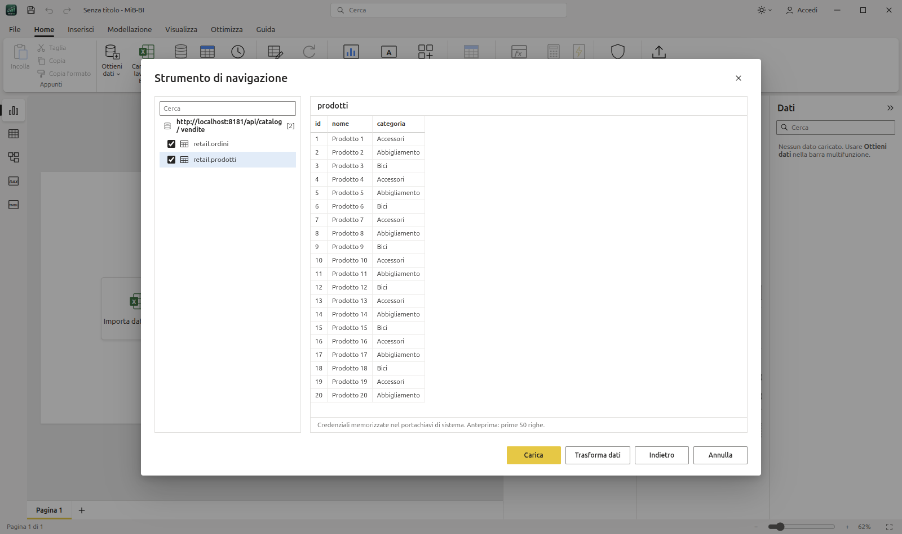

### Pubblica

**Pubblica** invia il report al servizio Power BI con le API REST, senza Power BI Desktop
(`electron/powerbi.cjs`). Il flusso è quello di Power BI Desktop: **1.** si inserisce l'e-mail aziendale e si
accede nella pagina Microsoft della propria organizzazione (browser di sistema, codice di autorizzazione + PKCE con
reindirizzamento su `http://localhost`; il tenant viene ricavato dal dominio dell'e-mail; in alternativa il codice
dispositivo); **2.** MiB-BI cerca **tutte** le aree di lavoro dell'account (con casella di ricerca; quelle in sola
lettura non sono selezionabili); **3.** si sceglie l'area di lavoro e il nome, poi *Pubblica*.

*Accedi* (barra del titolo, Pubblica, Ottieni dati › Power BI) chiede sempre per prima l'e-mail aziendale. Se MiB-BI non
è ancora autorizzata nell'organizzazione (nessuna app configurata), chiede solo l'**ID applicazione** fornito dall'IT e
prosegue con l'accesso; *Istruzioni da inviare all'IT* mostra la procedura di registrazione completa.

**Vai a Power BI** (menu account, Pubblica, Ottieni dati › Power BI) apre il servizio Power BI (`app.powerbi.com`) in una
finestra con sessione propria: si accede con le credenziali Microsoft dell'organizzazione e si naviga il servizio come nel
browser, senza bisogno dell'ID applicazione. È una vista web isolata: MiB-BI non ne legge i cookie né ne riusa il token.
Per *pubblicare* da MiB-BI serve comunque l'app registrata (sopra): sono due autorizzazioni distinte — la licenza del proprio
account (in genere Pro) e l'app che Microsoft consente di far accedere a Power BI a proprio nome.

Serve un'app registrata in Microsoft Entra ID (client pubblico, piattaforma *App per dispositivi mobili e desktop*
con `http://localhost`, autorizzazioni delegate *Power BI Service*: Workspace.Read.All, Dataset.ReadWrite.All,
Report.ReadWrite.All, Content.Create, Item.ReadWrite.All). Può essere quella dell'IT aziendale (*Impostazioni app*)
oppure un'app **multi-tenant** distribuita con MiB-BI (`electron/pbi-app.json` = `{ "clientId": "…" }` o
`MIBBI_PBI_CLIENT_ID`): in quel caso non si configura nulla, ma al primo accesso il tenant chiede il consenso
(dell'utente o, se l'organizzazione lo richiede, dell'amministratore). Gli errori di Entra più comuni (consenso
mancante, approvazione dell'amministratore, accesso condizionale, URI di reindirizzamento) vengono spiegati con
cosa chiedere all'IT. Il token di aggiornamento è cifrato con `safeStorage` in `~/.config/mib-bi/powerbi.json`.
**Profili**: uno per ogni app/tenant, ciascuno con il proprio accesso salvato.

**Ottieni dati › Power BI (report e modelli semantici)**: con lo stesso accesso, l'elenco delle aree di lavoro e il
loro contenuto. Un **report** viene scaricato come `.pbix` (*Export*, se il download è consentito) e aperto come un
file locale, con pagine, modello e dati; un **modello semantico** viene letto con query DAX (*executeQueries*:
`INFO.VIEW.TABLES/COLUMNS/MEASURES/RELATIONSHIPS` per lo schema, `EVALUATE 'Tabella'` per i dati, max 100.000
righe per tabella) e importato con relazioni, misure e cartelle.

- **Dataset push + report** (Power BI Pro, qualsiasi area di lavoro): dataset push con tabelle, relazioni e misure
  DAX, righe lette da DuckDB (10.000 per richiesta); colonne/tabelle calcolate come valori fissi, relazioni inattive e
  molti-a-molti omesse, max 5 milioni di righe per tabella. Il report è un `.pbix` "thin" (solo layout + connessione
  al dataset) caricato con *Imports* e collegato con *Rebind*; se l'importazione viene rifiutata si prova con l'API
  Fabric *Create Report*. Ripubblicando: schema aggiornato e righe sostituite (dataset ricreato se tabelle o relazioni
  cambiano).
- **Modello semantico completo** (aree di lavoro su capacità Fabric/Premium/PPU): API Fabric *Create/Update Semantic
  Model* con `model.bim` (TMSL) e *Create/Update Report* con `report.json` + `definition.pbir` collegato al modello,
  poi aggiornamento dati nel servizio. I dati locali sono incorporati nell'M di ogni tabella (JSON compresso, come
  *Immetti dati*): nessun gateway. Opzione per mantenere le connessioni MySQL/PostgreSQL (server raggiungibile o gateway).

Non verificato su un tenant reale: i flussi (accesso dal browser, elenco aree di lavoro, pubblicazione, download
dei report, lettura dei modelli) sono provati contro un server finto che riproduce le API
(`MIBBI_PBI_LOGIN`/`MIBBI_PBI_API`, `MIBBI_PBI_BROWSER_FETCH=1` segue il reindirizzamento senza aprire il browser).
Restano anche le alternative su file: `.pbit` per Power BI Desktop, progetto `.pbip` per l'integrazione Git di
Fabric, PDF, `.mibx` con i dati.

## Funzionalità (fasi 1–6)

- Barra del titolo personalizzata, ribbon Home/Inserisci/Modellazione/Visualizza/Ottimizza/Guida, menu File
- Import Testo/CSV, Excel (estensione DuckDB `excel`, richiede rete al primo uso), JSON, Parquet, dati di esempio *Financials*
- Strumento di navigazione con anteprima
- 26 tipi di visual: barre/istogrammi (raggruppati, in pila, 100%), linee, aree, linee + istogramma, nastro, cascata, dispersione,
  torta, anello, mappa ad albero, imbuto, misuratore, scheda, scheda con più righe, KPI, tabella, matrice, filtro dei dati, casella di testo
- Contenitori campi con aggregazioni (Somma, Media, Min, Max, Conteggio, Conteggio distinto, Non riepilogare)
- Riquadro Formato (assi, legenda, etichette dati, colori, titolo, sfondo, bordo, posizione)
- Filtri di base per visual / pagina / tutte le pagine, filtro incrociato, modalità messa a fuoco, ordinamento
- Pagine multiple (aggiungi, rinomina, duplica, elimina), zoom, griglia, allinea alla griglia
- Vista tabella con ordinamento
- Vista modello: tabelle trascinabili, linee di relazione con cardinalità (1 / *) e direzione del filtro, trascina colonna → colonna per creare una relazione, Canc per eliminarla
- Gestisci relazioni, Nuova/Modifica relazione con anteprima, validazione della cardinalità e dei percorsi attivi, rilevamento automatico
- Dati di esempio a stella: `financials` + `products` + `countries`
- Annulla/Ripeti, copia/incolla/duplica visual, salva/apri `.mibx`
- Scorciatoie: Ctrl+S/O/Z/Y/C/V/D, Canc, frecce (Shift = 10px)
- Editor di Power Query con passaggi applicati, codice M e SQL equivalente (vedi sopra)
- DAX: misure, colonne e tabelle calcolate, vista query DAX (vedi sopra)
- `.mibx` con dati incorporati, temi, esportazione PDF, progetti `.pbip` (PBIR/TMDL)
- Mappe (a bolle, con torte per legenda, e colorate) senza connessione: paesi, stati USA, regioni/province/comuni italiani,
  ~7.300 città del mondo, oppure latitudine/longitudine; zoom e trascinamento, filtro incrociato
- Oggetti visivi IA: albero di scomposizione (divisione IA valore alto/basso), influenzatori chiave (destinazione numerica o
  categorica, fattori numerici divisi in fasce, test di significatività) e narrazione intelligente della pagina
- Domande e risposte: motore locale (italiano/inglese, campi, misure, valori, "per", "primi N", tipo di grafico) oppure
  Claude (chiave API Anthropic nelle impostazioni del visual; riceve solo lo schema del modello e alcuni valori di esempio,
  mai le righe); "Trasforma in oggetto visivo"
- Oggetti visivi Python e R (`dataset` come in Power BI; Python con pandas + matplotlib, R con Rscript), da abilitare
  per sessione perché eseguono codice
- Segnalibri (dati, visualizzazione, pagina, solo oggetti visivi selezionati; importati ed esportati con i file Power BI),
  pulsanti con azione segnalibro, riquadro Selezione con livelli, oggetti visivi nascosti e gruppi
- Drill-down/drill-up con gerarchie (anche gerarchia automatica delle date Anno › Trimestre › Mese › Giorno), espandi tutto,
  drill-through (clic destro su un dato, campi di drill-through della pagina, pulsante Indietro), pagine come descrizione comando
- Parametri (Modellazione › Nuovo parametro): intervallo numerico di simulazione (tabella, misura `… Valore`, filtro dei dati
  a cursore) e parametri di campo (il filtro dei dati sceglie quali campi mostrano gli oggetti visivi); navigatore pagine e
  navigatore segnalibri, pulsanti Indietro/Segnalibro (Inserisci › Pulsanti)
- Formattazione condizionale (scale di colori, barre dei dati, icone) e sfumature dei colori dati nei grafici
- Grafica dei file Power BI rispettata: dimensioni e sfondi delle pagine, pagine nascoste, sfondo/bordo/titolo degli oggetti visivi,
  stili di schede, assi, legende, etichette, colori per categoria, tabelle e matrici, testo formattato, pulsanti e forme;
  la formattazione importata viene riscritta all'esportazione (anche gli oggetti visivi non supportati restano nel file)
- Riquadro **Analisi** dei grafici (linee/aree, istogrammi e barre, combinati, dispersione): linea costante (anche asse X nella
  dispersione), min, max, media, mediana, percentile e linea di tendenza (minimi quadrati), con nome, serie, colore, trasparenza,
  stile, larghezza, etichetta e **area ombreggiata** prima/dopo la linea; **previsione** (grafici a linee su asse continuo:
  livellamento esponenziale Holt-Winters con stagionalità automatica o indicata, intervallo di confidenza, punti ignorati)
  e **barre di errore** (limiti da campi, percentuale, deviazione standard). Importate ed esportate nei file Power BI con i
  nomi dello schema ufficiale (`y1AxisReferenceLine`, `averageLine`, `trend`, `forecast`, `error`, `shadeShow`/`shadeRegion`…).
  I grafici in pila hanno solo la linea costante, come in Power BI
- Pulsanti con tutte le azioni di Power BI: Indietro, Segnalibro, Drill-through (disabilitato finché non si seleziona un punto dati
  con i campi della pagina di destinazione), Spostamento tra le pagine, Q&A (apre **Esplora Q&A**), URL Web,
  **Applica tutti i filtri dei dati** (con il pulsante nella pagina le selezioni dei filtri dei dati restano in attesa) e
  **Cancella tutti i filtri dei dati**; scheda **Azione** nel riquadro Formato (tipo, destinazione, descrizione comando)
- **Interazioni tra oggetti visivi** (Formato › *Modifica interazioni*): per ogni coppia sorgente → destinazione *Filtro*,
  *Evidenzia* o *Nessuna*. L'evidenziazione incrociata è il comportamento predefinito come in Power BI (istogrammi e barre,
  combinati, torta, anello, treemap, imbuto, dispersione: il totale resta sbiadito e la parte selezionata è piena, la
  descrizione comando mostra *selezionato / totale*); tabelle, matrici, schede, mappe e filtri dei dati vengono filtrati.
  Opzioni › *Impostazioni report* passa al filtro incrociato predefinito (`defaultFilterActionIsDataFilter`). Le interazioni
  sono lette e scritte nei file Power BI (`relationships` della pagina, PBIR `visualInteractions`)
- **Filtri dei dati**: elenco, elenco a discesa, **riquadro/pulsanti**, **Tra**, **Prima di / Dopo** (date) e
  **Minore o uguale a / Maggiore o uguale a** (numeri) con cursore a due maniglie, **Data relativa** e **Ora relativa**
  (Ultimi / Questo / Prossimi N giorni, settimane, mesi, anni, anche *calendario*, *Includi oggi*), **testo**
  (contiene, non contiene, inizia con, è…); selezione singola, opzione *Seleziona tutto*, casella di ricerca. Import ed
  export con le proprietà dello schema ufficiale (`data.mode`, `startDate/endDate`, `numericStart/End`, `relativeRange`,
  `relativePeriod`, `selection.singleSelect`, `selfFilterEnabled`) e i tipi `slicer`, `advancedSlicerVisual`, `listSlicer`,
  `textSlicer`; i segnalibri ricordano anche intervalli, testo e periodi relativi
- **Sincronizza filtri dei dati** (Formato o Visualizza › Mostra riquadri): per ogni pagina *Sincronizza* e *Visibile*,
  nome del gruppo, sincronizzazione di campi e selezioni (`syncGroup` nei file Power BI)
- **Esporta dati** e **Mostra come tabella** (menu *Altre opzioni* dell'oggetto visivo e modalità messa a fuoco): dati
  riepilogati in .xlsx (max 150.000 righe) o .csv (max 30.000), dati sottostanti in .xlsx (righe delle tabelle con tutti i
  filtri attivi, filtro incrociato compreso)
- **Tema dell'interfaccia** chiaro, scuro o *Usa impostazione di sistema* (pulsante con il sole/la luna nella barra del titolo
  o Opzioni › Tema): barra multifunzione, riquadri, finestre, viste Tabella/Modello/Query DAX e Power Query; come in Power BI
  la pagina del report mantiene il proprio tema (Visualizza › Temi). La scelta è ricordata, anche per lo sfondo della finestra
- File › **Ottieni dati** (tutte le origini) e **Opzioni e impostazioni**: rilevamento automatico delle relazioni, interprete
  Python ed eseguibile Rscript per gli oggetti visivi script, chiave e modello Claude per Q&A, impostazioni origine dati,
  *Data/ora automatica* del file corrente (tabelle date e gerarchie nelle esportazioni)

## Stato

Fasi **1–12 completate**: interfaccia e report, Power Query, relazioni, DAX, file Power BI, connettori database, oggetti visivi e
IA, interattività, Power Query avanzato, modello/DAX, pubblicazione e servizio Power BI. Poi: modifica interazioni, nuovi
filtri dei dati, esportazione dati (1.5), tema scuro (1.6), calcoli visivi, funzioni DAX definite dall'utente e time
intelligence a calendario (1.7), salvataggio PBIR/TMDL, Personalizza tema, traduzioni del modello, interfaccia in
inglese, esportazione PowerPoint e avviso di aggiornamento (1.8), linguaggio M completo in Power Query (1.9), modelli
compositi (DirectQuery/Doppia), aggregazioni, aggiornamento incrementale, prospettive, OLS, descrizioni, gruppi e Vista TMDL (1.10), connettore Apache Polaris / cataloghi Iceberg REST (1.10.1).

**Da verificare** (implementato, provato solo con file di prova o server finti):
- servizio Power BI su un tenant reale: accesso, aree di lavoro, pubblicazione, download dei report, lettura dei
  modelli semantici, SharePoint in Power Query (serve un ID applicazione Entra, vedi *Pubblica*);
- in Power BI Desktop reale: icone della formattazione condizionale, tabelle date automatiche, etichette di
  riservatezza, linee di analisi/previsione/barre di errore e livelli delle gerarchie utente esportati;
- Q&A con una chiave API Claude reale; oggetti visivi R (richiede `r-base`);
- in Power BI Desktop reale: filtri dei dati Data relativa (il periodo è scritto come filtro calcolato al salvataggio
  più le impostazioni `relativeRange/Duration/Period`) e filtro dei dati di testo esportati;
- in Power BI Desktop reale: funzioni definite dall'utente, calendari e calcoli visivi scritti nei file (`.pbit`/`.pbip`
  con livello di compatibilità 1701/1702, righe `Function`/`Calendar` del `.pbix`);
- in Power BI Desktop reale: progetti PBIR/TMDL salvati da MiB-BI (convalidati solo con gli schemi JSON e il lettore di
  MiB-BI) e traduzioni (`Culture`/`ObjectTranslation` nel `.pbix`);
- in Power BI Desktop reale: `alternateOf`, `refreshPolicy` (espressione di polling), `pageRefresh` (durata in millisecondi),
  prospettive e OLS scritti da MiB-BI.

**Limiti noti**:
- dataset push senza ruoli, gruppi di calcolo e gerarchie (limite delle API Power BI);
- previsione e barre di errore: nei file Power BI solo aspetto e attivazione (lunghezza, confidenza e limiti da campi
  restano nel `.mibx`, nomi non presenti nello schema ufficiale);
- modelli semantici dal servizio: max 100.000 righe per tabella, senza pagine;
- calcoli visivi: niente ricalcolo nell'evidenziazione incrociata, niente `ROWNUMBER`/`RANK`/`INDEX`/`OFFSET`/`WINDOW` con
  assi; totali personalizzati solo nel `.mibx`.

- interfaccia inglese: i messaggi di errore generati nel processo principale (lettura file, connettori) restano in
  italiano; i totali personalizzati non vanno nel PBIR (lo schema li prevede come calcoli visivi con metadati non documentati).

- Power Query: niente `Pdf.Tables`/`Web.Page`, nessun query folding delle query M.

**Possibili prossimi passi**: Copilot con Claude.

## Test di fumo

`MIBBI_SHOT=out.png MIBBI_SCRIPT=passi.js npx electron . --no-sandbox` esegue `passi.js`
nella pagina (lo store è esposto come `window.__mibbi`, il query builder come `window.__mibbiQuery`, la query di un visual
con i filtri e il ruolo correnti come `window.__mibbiRun(visual)`),
stampa il valore restituito dallo script (`SCRIPT_RESULT {...}`), cattura uno screenshot ed esce.
`MIBBI_PBIT_OUT=out.pbit` salva l'esportazione `.pbit` senza finestra di dialogo. File `.pbix` di prova: cartella `data/`
del repository di pbixray (sample Microsoft).

## Dati geografici

`src/geo/` è generato da `node scripts/build-geo.mjs <cartella>`: confini dei paesi e città da
[Natural Earth](https://www.naturalearthdata.com/) (pubblico dominio, tramite `world-atlas`), stati USA da US Census
(pubblico dominio, tramite `us-atlas`), regioni, province e comuni italiani da
[openpolis/geojson-italy](https://github.com/openpolis/geojson-italy) su dati ISTAT (CC BY 4.0).
Stati e province di tutti i paesi (admin-1) e continenti da Natural Earth (`ne_10m_admin_1_states_provinces`,
`ne_50m_admin_0_countries`, pubblico dominio); codici postali (IT, US, DE, FR, ES, GB, CH, AT, NL, BE, PT) da
[GeoNames](https://download.geonames.org/export/zip/) (CC BY 4.0). `GEO_ONLY=admin1,continents,postal` rigenera solo
alcuni livelli. Le mappe usano la categoria dati della colonna (importata dal modello Power BI o impostata in
Vista dati › Strumenti colonna), altrimenti la deducono dal nome della colonna.

## Licenza

MIT — vedi [LICENSE](LICENSE). Progetto indipendente, non affiliato a Microsoft; Power BI è un marchio di Microsoft.
